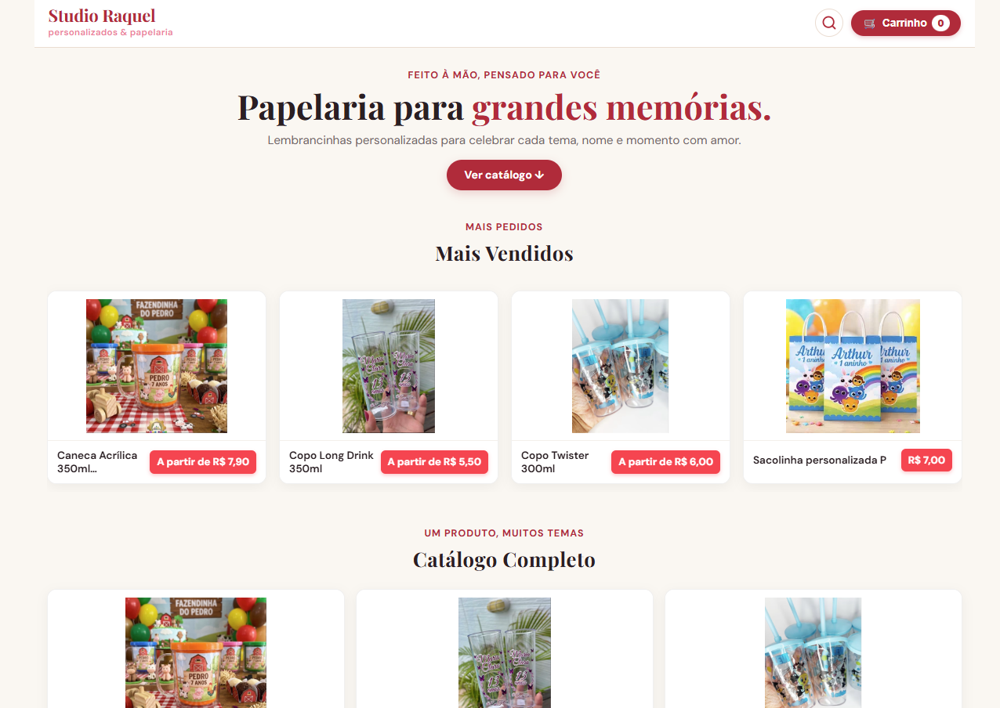

# Studio Raquel Personalizados

Site de catálogo e pedidos criado para uma **papelaria e loja de personalizados**. A experiência apresenta produtos para festas, lembrancinhas e outras celebrações, permitindo que cada cliente informe o tema e monte um pedido de acordo com a sua necessidade.



## Sobre o projeto

O Studio Raquel Personalizados reúne produtos feitos sob medida em uma interface responsiva e mobile-first. O catálogo inclui, entre outros itens:

- Caixas Milk, Pirâmide, Canudo, Sushi, Bala e Almofada;
- Caixas Maletinha, Sacolinhas personalizadas e embalagens para doces;
- Convite interativo, cartela de adesivos, etiquetas escolares e rótulos;
- Centros de mesa, plaquinhas, livrinhos e cards de colorir.

Os temas, nomes e imagens exibidos são referências: o cliente pode solicitar a personalização para o tema desejado. A página também conta com uma área institucional que apresenta a história da marca e uma chamada para solicitar orçamentos sob medida.


## Principais telas e recursos

- **Página inicial:** apresentação da marca, chamada para o catálogo e seção de produtos mais pedidos.
- **Catálogo completo:** cards com imagens, nomes, preços e acesso às opções de cada produto.
- **Personalização:** campo para informar o tema e seleção de opções extras quando disponíveis. O tema acompanha o item no carrinho e no pedido.
- **Carrinho lateral:** visualização dos itens, quantidades, adicionais e total do pedido.
- **Pedido mínimo:** o envio é liberado quando o subtotal chega a **R$ 40,00**; abaixo disso, a interface informa quanto falta.
- **Orçamento sob medida:** produtos ou modelos que não estão no catálogo podem ser solicitados pelo WhatsApp.
- **Rodapé e contato:** informações institucionais e acesso ao canal de atendimento.


## Fluxo de compra

1. A pessoa escolhe os produtos e modelos que combinam com a sua festa.
2. Informa o tema, nome, data e demais detalhes solicitados pelo produto.
3. Confere o carrinho e o valor total, respeitando o pedido mínimo de R$ 40,00.
4. Envia o pedido para atendimento e segue para o pagamento quando a cobrança é criada.
5. Após o pagamento, o pedido pode seguir para produção e atendimento personalizado.

A tela “Do seu jeito, do começo ao fim” resume esse caminho: escolha dos itens, envio dos detalhes e produção com carinho.


## Integração de back-end com n8n

O processamento do pedido é orquestrado por um workflow no **n8n**. De forma geral, o fluxo:

1. recebe o pedido enviado pelo site;
2. salva as informações em uma planilha;
3. separa o pedido por categoria;
4. cria a cobrança correspondente no Mercado Pago;
5. redireciona a pessoa de volta para o site.

No Mercado Pago, o cliente pode pagar com **cartão de crédito, cartão de débito ou Pix**.


## Personalização do catálogo

Os produtos e suas variantes ficam no início de `script.js`, no array `products`. Para atualizar o catálogo, altere os nomes, imagens e valores de `price` em reais (por exemplo, `12.5`). Quando `price` é `0`, a interface exibe “Preço sob consulta”.

O número usado pelo botão do WhatsApp está na constante `WHATSAPP_NUMBER`, no formato internacional e apenas com números.

As imagens dos produtos ficam em `assets/`. A organização atual inclui três referências visuais para diversos produtos, além de imagens usadas no banner e na apresentação da marca.

## Estrutura principal

```text
.
├── assets/           # Imagens dos produtos e da interface
├── docs/images/      # Screenshots da documentação
├── index.html        # Estrutura da página
├── script.js         # Catálogo, carrinho e fluxo do pedido
├── styles.css        # Estilos responsivos
└── CNAME             # Configuração do domínio, quando aplicável
```

## Publicação no GitHub Pages

1. Envie os arquivos para um repositório no GitHub.
2. Em **Settings → Pages**, escolha **Deploy from a branch**.
3. Selecione a branch `main` e a pasta `/ (root)`.
4. Salve e aguarde a publicação. O arquivo `index.html` será usado como entrada.

Não é necessário Azure para esta versão estática. O site também pode ser publicado em qualquer hospedagem de arquivos estáticos.
