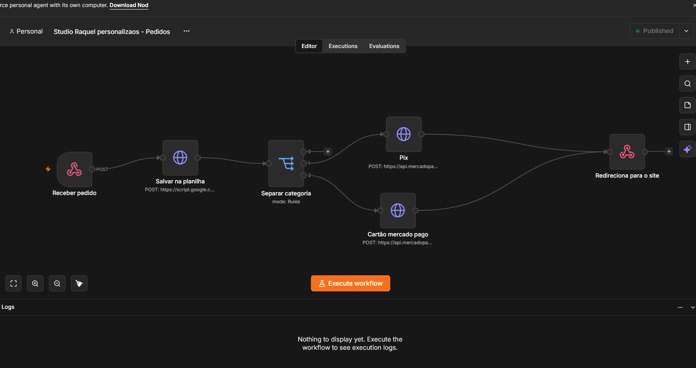
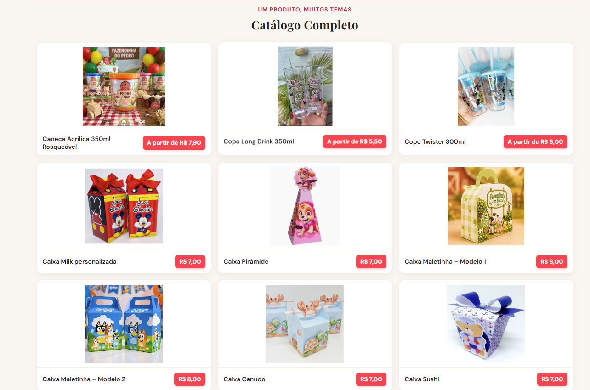
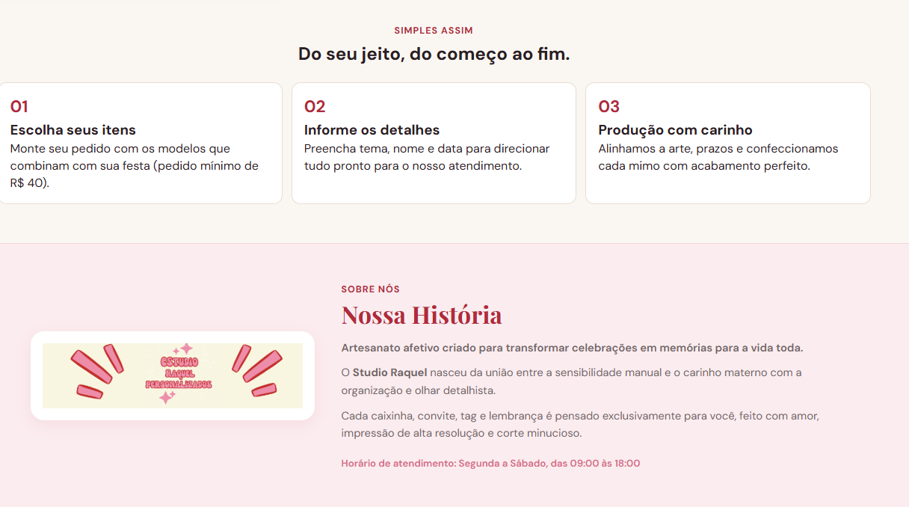
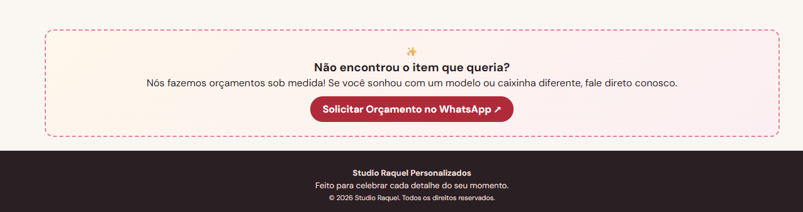

# Studio Raquel Personalizados

## Catálogo digital e jornada de pedidos para uma papelaria personalizada

Projeto de portfólio desenvolvido para uma **papelaria e loja de personalizados**. A solução transforma um catálogo de produtos para festas e celebrações em uma jornada de compra simples: o cliente escolhe os itens, informa o tema e os detalhes do pedido, confere o carrinho e segue para o pagamento.

> **Resumo:** uma vitrine digital responsiva para apresentar produtos personalizados e conectar o pedido do cliente a um fluxo automatizado de atendimento, organização e cobrança.


## Contexto de negócio

Uma loja de personalizados precisa apresentar muitos modelos, aceitar temas diferentes e organizar pedidos com informações específicas. O projeto foi pensado para reduzir atrito nessa jornada, valorizar o trabalho artesanal e dar ao negócio um fluxo mais estruturado do catálogo até a cobrança.

O catálogo reúne caixas, sacolinhas, embalagens para doces, convites, adesivos, etiquetas, centros de mesa, livrinhos e cards de colorir. Nomes, imagens e variantes funcionam como referências: o cliente pode solicitar o tema desejado.

## Principais funcionalidades

| Área | Experiência entregue |
| --- | --- |
| **Catálogo** | Produtos em destaque, catálogo completo, imagens, nomes e preços. |
| **Personalização** | Tema do evento e opções extras por produto, quando disponíveis. |
| **Carrinho** | Itens, quantidades, adicionais e total do pedido em uma visão lateral. |
| **Checkout** | Conferência do pedido e encaminhamento para o fluxo de atendimento e pagamento. |
| **Orçamento** | Solicitação de modelos sob medida pelo WhatsApp. |
| **Regras de negócio** | Pedido mínimo de R$ 40,00 e aviso do valor restante quando o limite ainda não foi atingido. |
| **Conteúdo institucional** | História da marca, processo de atendimento e informações de contato. |

### Fluxo de compra

1. O cliente escolhe os produtos e modelos que combinam com a celebração.
2. Informa tema, nome, data e os demais detalhes solicitados.
3. Revisa o carrinho e confirma o pedido, respeitando o mínimo de R$ 40,00.
4. O pedido é encaminhado para processamento e a cobrança é criada.
5. O cliente é redirecionado para concluir o pagamento e o pedido segue para atendimento e produção.

## Arquitetura e fluxo do back-end

O front-end é responsável pela apresentação do catálogo, personalização dos itens, carrinho e checkout. O processamento do pedido é orquestrado por um workflow no **n8n**, que conecta as etapas operacionais:

```text
Site / checkout
      │
      ▼
Receber pedido ──► Salvar dados em planilha ──► Separar por categoria
                                                        │
                             ┌──────────────────────────┴──────────────────────────┐
                             ▼                                                     ▼
                 Criar cobrança no Mercado Pago                         Redirecionar para o site
```

O workflow:

1. recebe os dados enviados pelo site;
2. salva as informações em uma planilha;
3. separa o pedido por categoria;
4. cria a cobrança no Mercado Pago;
5. redireciona o cliente para o site.

O Mercado Pago aceita **cartão de crédito, cartão de débito e Pix**.



## Tecnologias e ferramentas

- **HTML, CSS e JavaScript:** estrutura, estilos responsivos e comportamento da interface.
- **n8n:** orquestração do fluxo de pedidos.
- **Mercado Pago:** criação da cobrança e opções de pagamento.
- **WhatsApp:** canal de atendimento e solicitação de orçamentos.
- **GitHub Pages:** publicação da versão estática.

Não foram adicionados frameworks ou dependências externas: a implementação utiliza os recursos nativos da plataforma web.

## Destaques técnicos e aprendizados

- Modelagem de um catálogo orientado a dados no array `products`, facilitando a manutenção de nomes, imagens, preços e variantes.
- Construção de uma experiência responsiva e mobile-first para uma loja com muitos produtos visuais.
- Validação do pedido mínimo antes do envio e apresentação clara de base, adicionais e total quando aplicável.
- Integração entre a experiência de checkout e um fluxo externo de automação, mantendo separadas as responsabilidades do site e do processamento operacional.
- Organização de um fluxo de pagamento com retorno ao site e opções de cartão e Pix.

## Galeria do projeto

<p align="center">
  
</p>
<p align="center"><em>Visão inicial: posicionamento da marca, chamada para o catálogo e produtos em destaque.</em></p>

<p align="center">
  
</p>
<p align="center"><em>Catálogo completo: cards com imagens, nomes e preços para facilitar a descoberta dos produtos.</em></p>

<p align="center">
  
</p>
<p align="center"><em>Processo e história: escolha dos itens, envio dos detalhes e contexto da marca.</em></p>

<p align="center">
  
</p>
<p align="center"><em>Orçamento sob medida: canal para pedidos fora do catálogo e informações institucionais.</em></p>

<p align="center">
  
</p>
<p align="center"><em>Back-end visualizado no n8n: automação do pedido, organização dos dados e cobrança.</em></p>

## Organização do projeto

```text
.
├── assets/           # Imagens dos produtos e da interface
├── docs/images/      # Imagens usadas nesta documentação
├── index.html        # Estrutura da página
├── script.js         # Catálogo, carrinho e fluxo do pedido
├── styles.css        # Estilos responsivos
└── CNAME             # Configuração do domínio, quando aplicável
```

Os produtos e suas variantes ficam no início de `script.js`, no array `products`. Para atualizar o catálogo, altere nomes, imagens e valores de `price` em reais (por exemplo, `12.5`). Quando `price` é `0`, a interface exibe “Preço sob consulta”. O número usado pelo WhatsApp está na constante `WHATSAPP_NUMBER`, no formato internacional e apenas com números.

## Publicação

Para publicar no GitHub Pages, selecione **Deploy from a branch**, use a branch `main` e a pasta `/ (root)` em **Settings → Pages**. O arquivo `index.html` é o ponto de entrada. Por ser uma versão estática, o projeto também pode ser publicado em outras hospedagens de arquivos estáticos.
